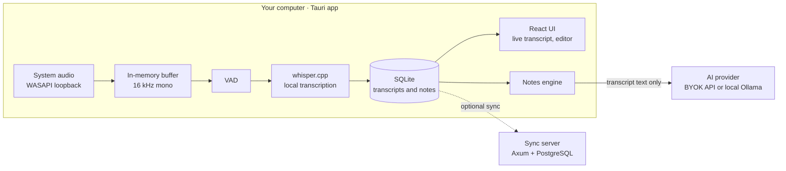

<div align="center">

# AnotAI

**Turn any lecture into structured study notes — without your audio ever leaving your computer.**

AnotAI is an open-source desktop app that captures your computer's audio during a class, transcribes it locally with Whisper, and uses AI to generate summaries, key concepts and flashcards, each linked back to the exact moment it was said.

[](https://github.com/MatheusSaleh/anotai/actions/workflows/ci.yml)
[](#license)


[Features](#features) · [How it works](#how-it-works) · [Getting started](#getting-started) · [Roadmap](#roadmap) · [Contributing](#contributing)

🇧🇷 [Leia em português](README.pt-BR.md)

<!-- Replace with a short GIF: start a session → live transcript → generated notes -->


</div>

---

## Why AnotAI

Most note-taking tools that transcribe audio send your recordings to a server. AnotAI is built the other way around:

- 🔒 **Your audio never leaves your machine.** Audio lives only in a bounded in-memory buffer and is discarded right after transcription. Nothing is written to disk or sent over the network.
- 🧠 **Local transcription.** Speech-to-text runs on your CPU or GPU through [whisper.cpp](https://github.com/ggerganov/whisper.cpp), and it keeps working offline.
- 🔑 **You choose the AI.** Notes are generated with your own API key (BYOK) or a fully local model through [Ollama](https://ollama.com). No account required.
- 📍 **Traceable notes.** Every item in a generated note links back to the transcript segment and timestamp it came from, so you can check what the AI wrote.
- 👁️ **No hidden recording.** Capture only starts when you press start, and a recording indicator is always visible.

## Features

> AnotAI is in early development. The checklist below shows what is done and what is planned. See the [roadmap](#roadmap).

**Capture and transcription**
- [ ] System audio capture on Windows (WASAPI loopback)
- [ ] Optional microphone input, off by default
- [ ] Live partial transcript while the class is running
- [ ] Voice activity detection to skip silence and avoid hallucinated text
- [ ] Tuned for Brazilian Portuguese, with other languages supported by Whisper
- [ ] Model manager: download, verify (SHA-256) and switch Whisper models

**AI notes**
- [ ] Structured notes: summary, topics, concepts, examples, conclusions
- [ ] Links from each note item to its source transcript segment
- [ ] Regenerate one section or the whole note without overwriting your edits
- [ ] Review questions and flashcards
- [ ] Providers: OpenAI-compatible APIs (BYOK) or local models via Ollama

**Notebook**
- [ ] Organize by course, subject and lecture
- [ ] Editor with autosave and version history
- [ ] Full-text search, filters and tags
- [ ] Export to Markdown, PDF and DOCX

**Optional sync server**
- [ ] Self-hostable server (Docker) to sync notebooks across devices

## How it works



1. You start a session, and AnotAI captures the system audio into a bounded in-memory buffer.
2. Audio is resampled to 16 kHz mono and windowed with overlap, so words are not cut at the edges.
3. Voice activity detection skips silence, and whisper.cpp transcribes speech locally.
4. Confirmed segments are stored in SQLite with timestamps. Partial results stream to the UI in real time.
5. When the session ends, the notes engine sends **text only** to the AI provider you configured and validates the response against a typed schema.
6. Optionally, a self-hosted sync server keeps your notebooks in sync across devices.

## Tech stack

| Layer | Technology |
| --- | --- |
| Desktop shell | [Tauri 2](https://tauri.app) (Rust) |
| UI | React + TypeScript |
| Audio capture | WASAPI loopback via Rust |
| Transcription | [whisper.cpp](https://github.com/ggerganov/whisper.cpp) via [`whisper-rs`](https://github.com/tazz4843/whisper-rs) |
| Local storage | SQLite via [SQLx](https://github.com/launchbadge/sqlx) |
| AI notes | OpenAI-compatible APIs or [Ollama](https://ollama.com) |
| Sync server (optional) | [Axum](https://github.com/tokio-rs/axum), [Tokio](https://tokio.rs), PostgreSQL via SQLx |
| Shared types | Rust → TypeScript generation with [`ts-rs`](https://github.com/Aleph-Alpha/ts-rs) |
| CI/CD | GitHub Actions: fmt, clippy, tests, signed Windows installers |

## Project structure

```
anotai/
├── crates/
│   ├── core/          # Domain types: sessions, segments, notes (no UI, no I/O)
│   ├── audio/         # System audio capture, resampling, windowing
│   ├── transcribe/    # TranscriptionEngine trait + whisper.cpp implementation
│   └── notes/         # Note generation, prompt templates, AI provider clients
├── apps/
│   ├── desktop/       # Tauri + React desktop app
│   └── sync-server/   # Optional Axum sync server
├── bench/             # Transcription benchmarks (WER, latency, memory)
└── docs/
    └── adr/           # Architecture Decision Records
```

The core logic lives in plain Rust crates that know nothing about Tauri or the UI. That keeps them testable in isolation and reusable by the desktop app, the sync server and the benchmarks.

## Getting started

### Download

Prebuilt Windows installers will be published on the [Releases](https://github.com/MatheusSaleh/anotai/releases) page starting with v0.1.

### Build from source (Windows)

**Prerequisites**

- [Rust](https://rustup.rs) (stable, `x86_64-pc-windows-msvc` toolchain)
- [Visual Studio Build Tools](https://visualstudio.microsoft.com/visual-cpp-build-tools/) with the **Desktop development with C++** workload
- [Node.js](https://nodejs.org) 20+ and [pnpm](https://pnpm.io)
- [CMake](https://cmake.org) and [LLVM/Clang](https://releases.llvm.org) (required to build whisper.cpp)
- Optional: [CUDA Toolkit](https://developer.nvidia.com/cuda-toolkit) or the [Vulkan SDK](https://vulkan.lunarg.com) for GPU acceleration

**Run the desktop app**

```bash
git clone https://github.com/MatheusSaleh/anotai.git
cd anotai/apps/desktop
pnpm install
pnpm tauri dev
```

On first launch, the onboarding downloads the default Whisper model and walks you through audio permissions.

**Run the tests**

```bash
cargo test --workspace
cargo clippy --workspace --all-targets -- -D warnings
```

> **Tip:** add your `target/` folder and `%USERPROFILE%\.cargo` to Windows Defender exclusions. Rust builds are much faster without real-time scanning.

### Optional: self-hosted sync server

```bash
cd apps/sync-server
cp .env.example .env
docker compose up -d
```

The server runs database migrations on startup and exposes the API at `http://localhost:8080`.

## Roadmap

| Version | Goal | Status |
| --- | --- | --- |
| **v0.1** | Capture system audio, transcribe live, save the transcript as Markdown | 🚧 In progress |
| **v0.2** | AI-generated notes (BYOK or local) with links back to the transcript | Planned |
| **v0.3** | Notebook: subjects, search, editor, version history, export | Planned |
| **v0.4** | Optional self-hosted sync server | Planned |
| Later | Linux (PipeWire) and macOS support | Exploring |

Planning happens in public on [GitHub Projects](https://github.com/MatheusSaleh/anotai/projects). Issues labeled [`good first issue`](https://github.com/MatheusSaleh/anotai/labels/good%20first%20issue) are a good place to start.

## Benchmarks

AnotAI publishes transcription benchmarks so model choices are backed by data rather than guesswork. Each run measures:

- **Word error rate** (WER) on Brazilian Portuguese
- **Real-time factor** and latency to the first partial result
- **Peak memory** and CPU/GPU usage

Results are broken down by Whisper model size, quantization and hardware profile. Evaluation uses openly licensed datasets such as [Mozilla Common Voice](https://commonvoice.mozilla.org), never recordings of real classes.

Results will be published in [`bench/`](bench/) with the v0.1 release.

## Architecture decisions

Significant technical choices are recorded as short [ADRs](docs/adr/), each with the context, the options considered and the trade-offs. Planned topics include:

- Local transcription with whisper.cpp vs. cloud speech-to-text APIs
- Local-first SQLite storage with optional sync vs. a mandatory backend
- PostgreSQL-backed job queue vs. Redis for the sync server
- SQLx vs. SeaORM

## Privacy and responsible use

AnotAI is designed to make covert recording impossible, not just discouraged:

- Capture only starts on an explicit user action, and an indicator stays visible for the whole session.
- Raw audio is never persisted or transmitted.
- Only transcript text is sent to the AI provider *you* configure. With a local model, nothing leaves your machine at all.
- Logs never contain audio, transcripts or note content.

**You are responsible for how you use AnotAI.** Recording or transcribing classes may require consent from the instructor or the institution, depending on local law and institutional policy. Check the rules that apply to you before using it.

## Contributing

Contributions are welcome, whether code, bug reports, benchmark results from different hardware, or documentation. Please read [CONTRIBUTING.md](CONTRIBUTING.md) before opening a pull request.

## License

Licensed under either of

- MIT license ([LICENSE-MIT](LICENSE-MIT))
- Apache License, Version 2.0 ([LICENSE-APACHE](LICENSE-APACHE))

at your option.

Whisper models are released by OpenAI under the MIT license and are downloaded separately on first use.

## Author

Built by **Matheus Saleh**, a backend developer working with Rust, PHP and TypeScript.

[LinkedIn](https://www.linkedin.com/in/matheussaleh)
