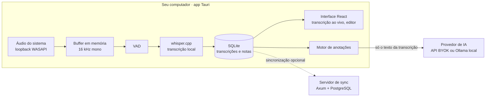

<div align="center">

# AnotAI

**Transforme qualquer aula em anotações de estudo estruturadas — sem que o áudio saia do seu computador.**

O AnotAI é um app desktop open source que captura o áudio do computador durante a aula, transcreve localmente com o Whisper e usa IA para gerar resumos, conceitos-chave e flashcards, cada um ligado ao momento exato em que foi dito.

[](https://github.com/MatheusSaleh/anotai/actions/workflows/ci.yml)
[](#licença)


[Funcionalidades](#funcionalidades) · [Como funciona](#como-funciona) · [Primeiros passos](#primeiros-passos) · [Roadmap](#roadmap) · [Como contribuir](#como-contribuir)

🇺🇸 [Read in English](README.md)

<!-- Substitua por um GIF curto: iniciar sessão → transcrição ao vivo → anotações geradas -->


</div>

---

## Por que o AnotAI

A maioria das ferramentas de anotação que transcrevem áudio envia suas gravações para um servidor. O AnotAI faz o contrário:

- 🔒 **O áudio nunca sai da sua máquina.** O áudio fica só num buffer limitado em memória e é descartado logo depois da transcrição. Nada é gravado em disco nem enviado pela rede.
- 🧠 **Transcrição local.** A conversão de fala em texto roda na sua CPU ou GPU com o [whisper.cpp](https://github.com/ggerganov/whisper.cpp) e funciona offline.
- 🔑 **Você escolhe a IA.** As anotações são geradas com a sua própria chave de API (BYOK) ou com um modelo totalmente local via [Ollama](https://ollama.com). Não é preciso criar conta.
- 📍 **Anotações rastreáveis.** Cada item de uma anotação aponta para o trecho da transcrição e o timestamp de onde veio, para você conferir o que a IA escreveu.
- 👁️ **Sem gravação oculta.** A captura só começa quando você clica em iniciar, e um indicador de gravação fica sempre visível.

## Funcionalidades

> O AnotAI está no início do desenvolvimento. A lista abaixo mostra o que já existe e o que está planejado. Veja o [roadmap](#roadmap).

**Captura e transcrição**
- [ ] Captura do áudio do sistema no Windows (loopback WASAPI)
- [ ] Microfone opcional, desligado por padrão
- [ ] Transcrição parcial ao vivo durante a aula
- [ ] Detecção de voz para ignorar silêncio e evitar texto inventado
- [ ] Ajustado para português brasileiro, com os demais idiomas suportados pelo Whisper
- [ ] Gerenciador de modelos: baixar, verificar (SHA-256) e trocar modelos do Whisper

**Anotações com IA**
- [ ] Anotações estruturadas: resumo, tópicos, conceitos, exemplos, conclusões
- [ ] Ligação de cada item ao trecho de origem na transcrição
- [ ] Regenerar uma seção ou a nota inteira sem sobrescrever suas edições
- [ ] Perguntas de revisão e flashcards
- [ ] Provedores: APIs compatíveis com OpenAI (BYOK) ou modelos locais via Ollama

**Caderno**
- [ ] Organização por curso, disciplina e aula
- [ ] Editor com salvamento automático e histórico de versões
- [ ] Busca no conteúdo, filtros e etiquetas
- [ ] Exportação para Markdown, PDF e DOCX

**Servidor de sincronização opcional**
- [ ] Servidor self-hosted (Docker) para sincronizar cadernos entre dispositivos

## Como funciona



1. Você inicia uma sessão, e o AnotAI captura o áudio do sistema num buffer limitado em memória.
2. O áudio é reamostrado para 16 kHz mono e dividido em janelas sobrepostas, para não cortar palavras nas bordas.
3. A detecção de voz ignora o silêncio, e o whisper.cpp transcreve a fala localmente.
4. Os segmentos confirmados são salvos no SQLite com timestamps. Os resultados parciais aparecem na tela em tempo real.
5. Ao fim da sessão, o motor de anotações envia **só texto** para o provedor de IA que você configurou e valida a resposta contra um esquema tipado.
6. Opcionalmente, um servidor de sincronização self-hosted mantém os cadernos sincronizados entre dispositivos.

## Stack

| Camada | Tecnologia |
| --- | --- |
| Shell desktop | [Tauri 2](https://tauri.app) (Rust) |
| Interface | React + TypeScript |
| Captura de áudio | Loopback WASAPI via Rust |
| Transcrição | [whisper.cpp](https://github.com/ggerganov/whisper.cpp) via [`whisper-rs`](https://github.com/tazz4843/whisper-rs) |
| Armazenamento local | SQLite via [SQLx](https://github.com/launchbadge/sqlx) |
| Anotações com IA | APIs compatíveis com OpenAI ou [Ollama](https://ollama.com) |
| Servidor de sync (opcional) | [Axum](https://github.com/tokio-rs/axum), [Tokio](https://tokio.rs), PostgreSQL via SQLx |
| Tipos compartilhados | Geração Rust → TypeScript com [`ts-rs`](https://github.com/Aleph-Alpha/ts-rs) |
| CI/CD | GitHub Actions: fmt, clippy, testes, instaladores Windows assinados |

## Estrutura do projeto

```
anotai/
├── crates/
│   ├── core/          # Tipos de domínio: sessões, segmentos, notas (sem UI, sem I/O)
│   ├── audio/         # Captura do áudio do sistema, reamostragem, janelamento
│   ├── transcribe/    # Trait TranscriptionEngine + implementação com whisper.cpp
│   ├── session/       # Pipeline da sessão: captura → VAD → transcrição → eventos
│   └── storage/       # Persistência em SQLite e exportação em Markdown
├── apps/
│   ├── cli/           # CLI `anotai`, de ponta a ponta sem interface
│   ├── desktop/       # App desktop Tauri + React
│   └── sync-server/   # Servidor de sincronização opcional em Axum
├── bench/             # Benchmarks de transcrição (WER, latência, memória)
└── docs/
    └── adr/           # Architecture Decision Records
```

A lógica central fica em crates Rust que não conhecem o Tauri nem a interface. Isso permite testá-los isoladamente e reaproveitá-los no app desktop, no servidor de sincronização e nos benchmarks.

## Primeiros passos

### Download

Instaladores prontos para Windows serão publicados na página de [Releases](https://github.com/MatheusSaleh/anotai/releases) a partir da v0.1.

### Compilar a partir do código (Windows)

**Pré-requisitos**

- [Rust](https://rustup.rs) (stable, toolchain `x86_64-pc-windows-msvc`)
- [Visual Studio Build Tools](https://visualstudio.microsoft.com/visual-cpp-build-tools/) com o workload **Desenvolvimento para desktop com C++**
- [Node.js](https://nodejs.org) 20+ e [pnpm](https://pnpm.io)
- [CMake](https://cmake.org) e [LLVM/Clang](https://releases.llvm.org) (necessários para compilar o whisper.cpp)
- Opcional: [CUDA Toolkit](https://developer.nvidia.com/cuda-toolkit) ou [Vulkan SDK](https://vulkan.lunarg.com) para aceleração por GPU

**Rodar o app desktop**

```bash
git clone https://github.com/MatheusSaleh/anotai.git
cd anotai/apps/desktop
pnpm install
pnpm tauri dev
```

Na primeira execução, o onboarding baixa o modelo padrão do Whisper e guia você pelas permissões de áudio.

**Rodar os testes**

```bash
cargo test --workspace
cargo clippy --workspace --all-targets -- -D warnings
```

> **Dica:** adicione a pasta `target/` e `%USERPROFILE%\.cargo` às exclusões do Windows Defender. Os builds de Rust ficam bem mais rápidos sem a verificação em tempo real.

### Opcional: servidor de sincronização self-hosted

```bash
cd apps/sync-server
cp .env.example .env
docker compose up -d
```

O servidor executa as migrations ao iniciar e expõe a API em `http://localhost:8080`.

## Roadmap

| Versão | Objetivo | Status |
| --- | --- | --- |
| **v0.1** | Capturar o áudio do sistema, transcrever ao vivo e salvar a transcrição em Markdown | 🚧 Em andamento |
| **v0.2** | Anotações geradas por IA (BYOK ou local) com ligação à transcrição | Planejado |
| **v0.3** | Caderno: disciplinas, busca, editor, histórico de versões, exportação | Planejado |
| **v0.4** | Servidor de sincronização self-hosted opcional | Planejado |
| Depois | Suporte a Linux (PipeWire) e macOS | Em estudo |

O planejamento é público no [GitHub Projects](https://github.com/MatheusSaleh/anotai/projects). Issues marcadas com [`good first issue`](https://github.com/MatheusSaleh/anotai/labels/good%20first%20issue) são um bom ponto de partida.

## Benchmarks

O AnotAI publica benchmarks de transcrição para que a escolha de modelos se apoie em dados, e não em suposições. Cada execução mede:

- **Taxa de erro de palavras** (WER) em português brasileiro
- **Fator de tempo real** e latência até o primeiro resultado parcial
- **Pico de memória** e uso de CPU/GPU

Os resultados são separados por tamanho de modelo do Whisper, quantização e perfil de hardware. A avaliação usa datasets com licença aberta, como o [Mozilla Common Voice](https://commonvoice.mozilla.org), e nunca gravações de aulas reais.

Os resultados serão publicados em [`bench/`](bench/) junto com a v0.1.

## Decisões de arquitetura

As escolhas técnicas importantes são registradas em [ADRs](docs/adr/) curtos, cada um com o contexto, as opções avaliadas e os trade-offs. Temas previstos:

- Transcrição local com whisper.cpp × APIs de transcrição na nuvem
- Armazenamento local-first em SQLite com sync opcional × backend obrigatório
- Fila de jobs no PostgreSQL × Redis no servidor de sincronização
- SQLx × SeaORM

## Privacidade e uso responsável

O AnotAI foi projetado para tornar a gravação oculta impossível, e não apenas desaconselhada:

- A captura só começa por uma ação explícita do usuário, e um indicador fica visível durante toda a sessão.
- O áudio bruto nunca é gravado nem transmitido.
- Só o texto da transcrição é enviado ao provedor de IA que *você* configurou. Com um modelo local, nada sai da sua máquina.
- Os logs nunca contêm áudio, transcrições ou o conteúdo das anotações.

**Você é responsável pela forma como usa o AnotAI.** Gravar ou transcrever aulas pode exigir o consentimento do professor ou da instituição, conforme a legislação local e as regras da instituição. Verifique as regras que se aplicam a você antes de usar.

## Como contribuir

Contribuições são bem-vindas, seja código, relato de bugs, resultados de benchmark em outros hardwares ou documentação. Leia o [CONTRIBUTING.md](CONTRIBUTING.md) antes de abrir um pull request.

## Licença

Distribuído sob uma das licenças abaixo, à sua escolha:

- Licença MIT ([LICENSE-MIT](LICENSE-MIT))
- Licença Apache, versão 2.0 ([LICENSE-APACHE](LICENSE-APACHE))

Os modelos do Whisper são publicados pela OpenAI sob licença MIT e são baixados separadamente no primeiro uso.

## Autor

Desenvolvido por **Matheus Saleh**, desenvolvedor backend que trabalha com Rust, PHP e TypeScript.

[LinkedIn](https://www.linkedin.com/in/matheussaleh)
